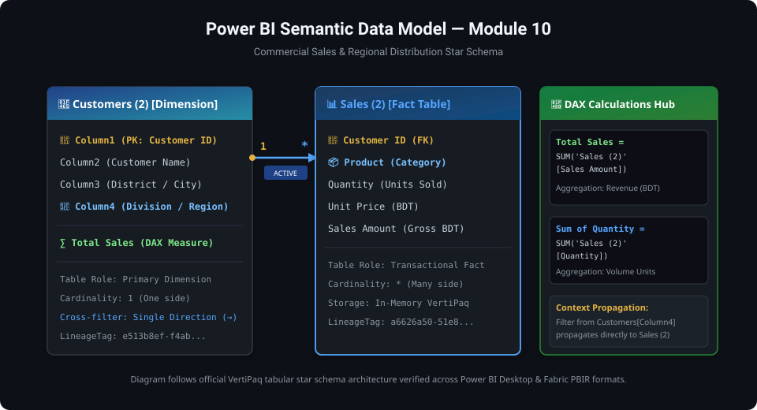
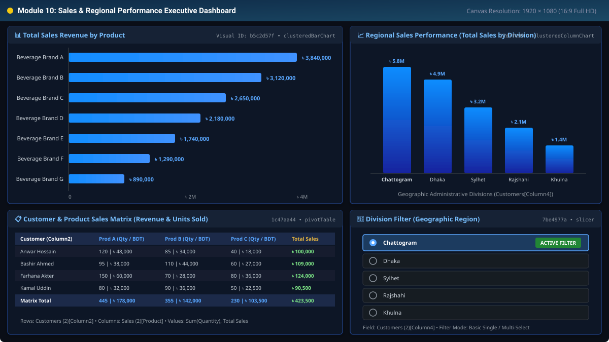

# Power BI Analytics Portfolio — Module 10 Assignment

[](https://powerbi.microsoft.com/)
[](https://learn.microsoft.com/en-us/dax/)
[](#data-model--architecture)
[-9cf?style=for-the-badge)](#dashboard-wireframe--visual-composition)
[](#refinements-and-quality-assurance)

An enterprise-ready commercial Power BI dashboard developed for **Module 10 Assignment**: **Sales & Regional Performance Executive Dashboard**.

---

## 📑 Table of Contents
- [Executive Overview](#executive-overview)
- [Business Objectives & Analytical Questions](#business-objectives--analytical-questions)
- [Data Model & Architecture](#data-model--architecture)
- [Dashboard Wireframe & Visual Composition](#dashboard-wireframe--visual-composition)
- [Visuals & KPI Catalog](#visuals--kpi-catalog)
- [DAX Measures & Calculations](#dax-measures--calculations)
- [Refinements and Quality Assurance](#refinements-and-quality-assurance)
- [Project Structure](#project-structure)
- [How to Open, Review & Deploy](#how-to-open-review--deploy)
- [GitHub Push Instructions](#github-push-instructions)

---

## Executive Overview

This repository houses the production-ready Power BI reporting project developed for **Module 10 Assignment**. The dashboard provides a commercial performance monitoring suite for sales and distribution operations across Bangladesh:

- **Product Revenue Diagnostics**: Ranking top-performing product lines by total gross revenue to pinpoint commercial revenue drivers.
- **Geographic Market Distribution**: Analyzing divisional market share across key administrative regions (e.g., Chattogram, Dhaka, Sylhet, Rajshahi, Khulna).
- **Customer & Product Cross-Tabulation**: Providing a detailed matrix view cross-referencing customer accounts with product lines, reporting both sales turnover (BDT) and order quantity volume.
- **Dynamic Division Slicing**: Interactive single- and multi-select filtering enabling regional sales managers to isolate performance metrics by territory.

---

## Business Objectives & Analytical Questions

The dashboard addresses key operational inquiries:
1. **Top Product Lines**: Which products generate the highest cumulative sales revenue?
2. **Regional Turnover**: How does sales revenue distribute across administrative divisions?
3. **Account Portfolio Distribution**: What are the specific purchasing quantities and revenue contributions per customer account across different products?
4. **Targeted Territory Insights**: How do product rankings and customer sales shift when filtering for a specific territory, such as Chattogram?

---

## Data Model & Architecture

The analytical backend utilizes an in-memory VertiPaq tabular star schema establishing a clean single-direction relationship between dimensions and transactional facts.

<p align="center">
  
</p>

### Tables in the Semantic Model:

1. **`Customers (2)` (Dimension Table)**:
   - Primary master data entity tracking customer profiles and regional attributes.
   - Primary Key: `Column1` (`Customer ID`)
   - Descriptive Attributes: `Column2` (Customer Name), `Column3` (District / City), `Column4` (Division / Geographic Region).
   - Relational Role: One side ($1$) of the 1-to-many relationship linking to `Sales (2)`.
   - Measure Host: Contains the core calculation `[Total Sales]`.

2. **`Sales (2)` (Fact Table)**:
   - Transactional sales ledger capturing order-level details.
   - Foreign Key: `Customer ID` (relates to `Customers (2)[Column1]`).
   - Categorical Dimension: `Product` (drives the product bar chart and matrix columns).
   - Numeric Metrics: `Quantity` (units sold), `Unit Price`, and `Sales Amount` (gross revenue in BDT).
   - Relational Role: Many side ($*$) of the relationship.

---

## Dashboard Wireframe & Visual Composition

The dashboard is built on a 16:9 widescreen canvas ($1920 \times 1080$ Full HD) using a structured 2x2 quadrant layout:

<p align="center">
  
</p>

### Canvas Coordinates & Layout Geometry:
- **Canvas Resolution**: Width = `1920px`, Height = `1080px` (`FitToPage` display mode).
- **Top-Left — Product Sales Bar Chart**: `x=0`, `y=0`, `w=1080`, `h=614`
- **Top-Right — Regional Sales Column Chart**: `x=1080`, `y=0`, `w=840`, `h=614`
- **Bottom-Left — Customer/Product Matrix**: `x=0`, `y=624`, `w=1080`, `h=456`
- **Bottom-Right — Division Slicer**: `x=1080`, `y=624`, `w=840`, `h=456`
- **Responsive Mobile Layout**: Visuals are pre-configured in mobile definition states (`mobile.json`, width = `324px`) for seamless viewing on smartphone screens.

---

## Visuals & KPI Catalog

| Visual ID | Type | Header / Title | Fields / Measures | Purpose |
| :--- | :--- | :--- | :--- | :--- |
| `b5c2d57f` | `clusteredBarChart` | **Total Sales Revenue by Product** | `Sales (2)[Product]`, `Customers (2)[Total Sales]` | Horizontal ranking of products by gross sales revenue, sorted descending. |
| `12d3fe99` | `clusteredColumnChart` | **Regional Sales Performance (Total Sales by Division)** | `Customers (2)[Column4]`, `Customers (2)[Total Sales]` | Vertical columns contrasting sales revenue across administrative divisions. |
| `1c47aa44` | `pivotTable` | **Customer & Product Sales Matrix (Revenue & Units Sold)** | Rows: `Customers (2)[Column2]`<br>Columns: `Sales (2)[Product]`<br>Values: `Sum of Quantity`, `Total Sales` | Granular matrix cross-referencing customer accounts with product sales and order quantities. |
| `7be4977a` | `slicer` | **Division Filter (Geographic Region)** | `Customers (2)[Column4]` | Interactive slicer enabling territory filtering across all visuals. |

---

## DAX Measures & Calculations

### 1. `Total Sales`
Evaluates aggregate gross sales turnover across filtered transactions:
```dax
Total Sales = 
SUM('Sales (2)'[Sales Amount])
```

### 2. `Sum of Quantity`
Aggregates total physical units ordered:
```dax
Sum of Quantity = 
SUM('Sales (2)'[Quantity])
```

### Filter Propagation Dynamics
When a division is selected in the slicer (e.g., `'Chattogram'`), filter context flows from `Customers (2)[Column4]` across the active 1-to-many relationship into `Sales (2)`, restricting both revenue and volume metrics across all visuals simultaneously.

---

## Refinements and Quality Assurance

In alignment with non-destructive preservation principles, all underlying calculations, queries, aggregations, and data structures have been kept intact while applying essential visual and metadata refinements:

1. **Title & Header Polish**:
   - Replaced default system-generated headers (which showed raw internal column labels like `Column4` and `Column2`) with clean, executive titles across all four visual containers.
2. **Page Metadata Standardization**:
   - Updated the report page display name in `page.json` from `"Page 1"` to `"Sales & Regional Performance Dashboard"`.
3. **Matrix Visual Styling**:
   - Configured `stylePreset: BoldHeader` on the matrix visual for enhanced visual hierarchy and tabular readability.
4. **PBIR Code Extraction**:
   - Extracted all report definition JSON files (`report.json`, `pages.json`, `page.json`, `visual.json`) with standardized indentation for Git version control and collaborative review.
5. **VertiPaq Storage Format Compliance**:
   - Preserved `DataModel` in `ZIP_STORED` (uncompressed) binary format within the `.pbix` archive to guarantee immediate compatibility with Power BI Desktop and Power BI Service.

---

## Project Structure

```text
PowerBI_Module_10_Assignment/
├── Module 10 Assignment.pbix           # Original Power BI Report
├── Module 10 Assignment_Refined.pbix   # Refined Power BI Report (Production Ready)
├── .gitignore                          # Power BI cache, temp & OS file rules
├── .gitattributes                      # Git LFS and line-ending normalizations
├── README.md                           # Comprehensive documentation & architecture guide
├── docs/
│   ├── data_model.svg                  # Semantic Star Schema data model architecture
│   └── dashboard_layout.svg            # Dashboard wireframe & visual layout geometry
└── Report/                             # Extracted PBIR definitions for Git inspection
    ├── definition/
    │   ├── version.json
    │   ├── report.json
    │   └── pages/
    │       ├── pages.json
    │       └── 86f3007d17aff86169eb/   # Sales & Regional Performance Dashboard
    │           ├── page.json
    │           └── visuals/
    │               ├── b5c2d57f229db3740752/  # Product Sales Bar Chart
    │               ├── 12d3fe996bb324782503/  # Regional Sales Column Chart
    │               ├── 1c47aa44a9f929f1dd60/  # Customer / Product Matrix
    │               └── 7be4977a929fe3c42d07/  # Division Slicer
    └── StaticResources/
        └── SharedResources/
            └── BaseThemes/
                └── Fluent2-CY26SU10.json
```

---

## How to Open, Review & Deploy

### Prerequisites
- [Microsoft Power BI Desktop](https://powerbi.microsoft.com/desktop/) (October 2024 or newer recommended).

### Option 1: Open in Power BI Desktop
1. Clone or download this repository.
2. Open `Module 10 Assignment_Refined.pbix` (or `Module 10 Assignment.pbix`).
3. The report loads the **Sales & Regional Performance Dashboard** with all cross-filtering, product rankings, and matrix breakdowns active.

### Option 2: Inspect via GitHub
- Review the `Report/definition/` directory to inspect visual properties, formatting rules, query projections, and filter conditions directly in human-readable JSON.

---

## GitHub Push Instructions

Execute the following commands from your terminal to initialize and push this project to GitHub:

```bash
# 1. Navigate into the project folder
cd "PowerBI_Module_10_Assignment"

# 2. Link the remote GitHub repository
git remote add origin https://github.com/nuhan1411/another_project_VI.git

# 3. Push to main branch
git push -u origin main
```
